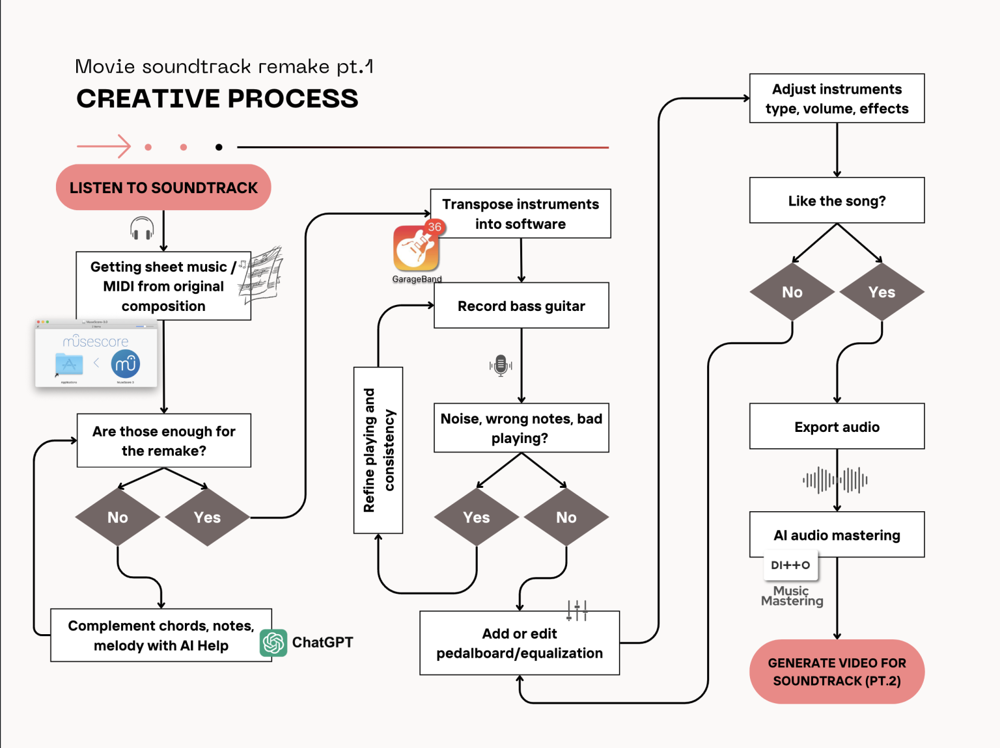
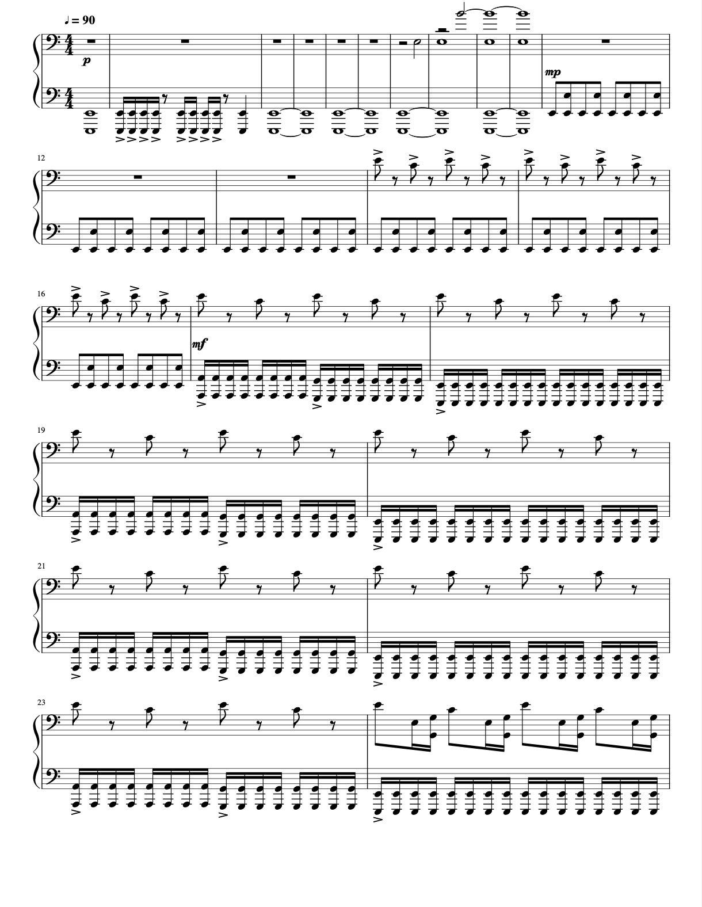
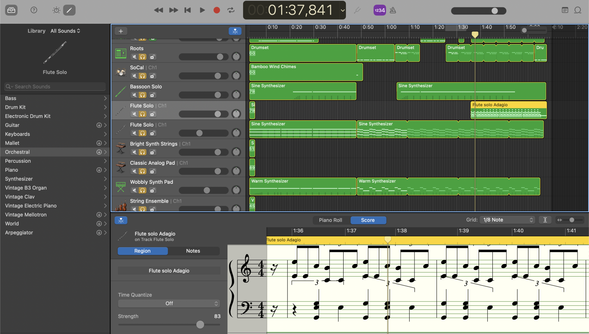
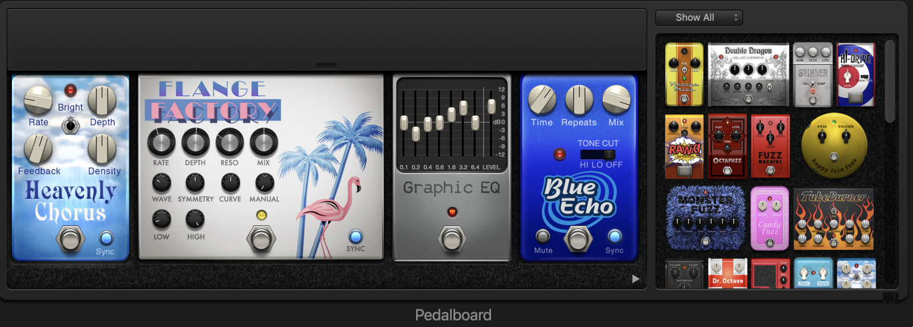
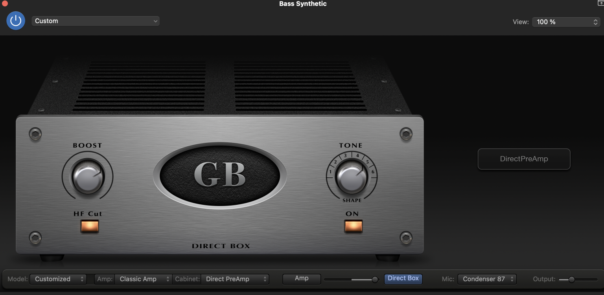

**Intro:** I've always been fascinated by the fusion of technology and art. Recently, I got inspired by a movie and decided to remake a soundtrack piece (I'm not going to mention which one until next post 😉), followed by creating a video that complements the produced track.

This blog post will cover the first part: the process of remaking a movie soundtrack using a combination of basic music theory, modern tech tools (AI + Apple's), and creative instincts.

> The flowchart attached above outlines the steps I took to bring this idea to life. Let's dive into each step of the creative process!

* * *

**Part 1: Remaking the Soundtrack**

**Step 1: Listen to the Soundtrack (multiple times):** This step is crucial for getting a feel for the composition—understanding its emotional weight, instrumentation, tempo, and overall atmosphere.

**Step 2: Obtain Sheet Music or MIDI from the Original Composition**: Once familiar with the soundtrack, the next step was to obtain the sheet music or MIDI file for the original composition. Platforms like _Musescore_ are excellent resources for this. Having the sheet music or MIDI gives me a solid foundation—a road map of the song's structure, melodies, harmonies, and rhythms.

**Step 3: Evaluate the Sufficiency of the Sheet Music or MIDI**: With the sheet music or MIDI file in hand, I assessed whether it contained enough detail to recreate the soundtrack faithfully. Sometimes, sheet music might not include every nuance or expressive element of the original performance.

**Step 3.1: Using AI to Complement Missing Elements** If I found the sheet music lacking in certain areas (chords, notes, or melodic lines), I leveraged AI tools like _ChatGPT_ to help fill in the gaps. The AI can suggest alternate chords, enhance melodies, or even propose new rhythmic patterns that align with the original vibe.

**Step 4: Transpose Instruments into Software (GarageBand)** Once I had all the necessary elements, I transposed the music into GarageBand, my DAW of choice for this project. Here, I began crafting the digital version of the soundtrack. Each instrument is carefully chosen to match the timbre of the original soundtrack, but with slight variations that reflect my creative interpretation.

**Step 5: Recording Bass Guitar** To add a personal touch and a sense of authenticity, I recorded the bass guitar myself. The bass line is crucial for anchoring the harmony and driving the rhythm. This step involved setting up the recording gear, tuning the instrument, and laying down multiple takes to ensure precision and feel.

**Step 6: Refine Playing and Consistency** After recording, I carefully reviewed the bass track for any unwanted noise, incorrect notes, or inconsistencies in playing. It's important that the recording is clean and fits well within the mix.

**Step 6.1: If Necessary, Re-record or Edit** If any flaws were found, I went back to re-recording the parts or making necessary edits until I was satisfied with the overall quality and consistency.

**Step 7: Add or Edit Pedalboard/Equalization** The next step was to fine-tune the sound using pedalboard effects and equalization settings. For this project, I experimented with fuzz, flanger, and distortion effects on the bass to create a more dramatic and textured sound. Additionally, I layered multiple drum tracks to intensify the dynamic range and add more cinematic tension.

**Step 8: Adjust Instrument Types, Volume, and Effects** At this stage, I made precise adjustments to instrument types, volumes, and effects to ensure that every element of the mix complemented each other. The goal was to create a cohesive sound where every instrument plays its part without overpowering others.

**Step 9: Assess the Final Mix** After the adjustments, I listened to the entire track critically. This step is about introspection—does the track sound right? Does it convey the intended emotion and power?

**Step 9.1: If Not Satisfied, Return to Step 7** If the mix didn't quite hit the mark, I revisited the pedalboard and equalization settings, adjusted the mix, or even re-recorded parts to refine the sound further.

**Step 9.2: If Satisfied, Export the Audio** When everything sounded right and the song felt complete, I exported the audio file, ready for the mastering phase.

**Step 10: Use AI Tools for Audio Mastering** To achieve a professional-level finish, I utilized AI-powered mastering tools like DITTO Music Mastering. These tools analyze the track and make precise adjustments to enhance dynamics, EQ, and overall clarity, ensuring the music translates well across various playback systems.

* * *

**Part 2: Generating a Video for the Soundtrack (Coming Soon!)**

With the soundtrack remake complete, the next phase is to create a video that visually narrates the music's story. This will involve a combination of AI-assisted video generation, scripting, and my photography skills. Stay tuned for Part 2, where I'll break down the entire video creation process step-by-step.

As a tech creative, being able to blend music production, AI, and video creation is both challenging and incredibly rewarding. The journey is full of learning, experimentation, and growth. I hope this blog inspires you to explore your creative side, whether in music, video, coding, or any other medium.

Chao! 🎧📽️
